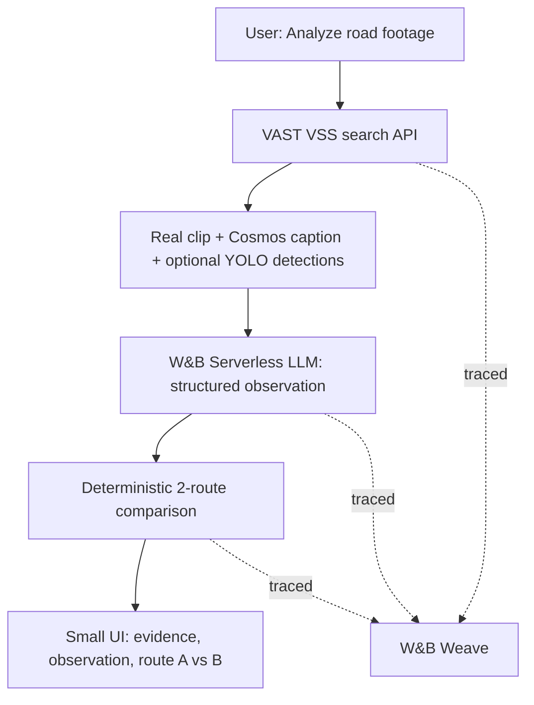

# SafeRoute — Smallest Working Hackathon MVP

**VAST Builders Challenge · NYC · October 9, 2026**  
**Objective:** Ship one *working, deployed* evidence-backed route-reassessment demo by the 4:30 PM submission window.  
**Build location:** **Only the assigned VAST workshop VM and its team Kubernetes namespace.** Use Claude Code or Codex as desired.  
**Source of truth:** [Official VAST Build Day README](https://github.com/vast-data/vast-builders-challenge#vast-builders-challenge-video-agents) and the repo's `.cursor/skills/` files. They are standard `SKILL.md` instructions; do **not** need to use Cursor itself.

## 1. Pitch and scope

**Pitch:** *“Maps can tell you a road is empty. SafeRoute shows the video evidence that might explain why—and reevaluates a route accordingly.”*

**Smallest demo:** User clicks **Analyze road footage**. SafeRoute retrieves **one real, indexed traffic video segment** from the team's VAST video search index; displays the playable clip, its timestamp, Cosmos Reason caption, and available YOLO11 detection metadata; has a **Weights & Biases (W&B) inference model** interpret the evidence as `normal`, `congested`, `possible_obstruction`, or `unknown`; updates the cost of **one edge of a tiny, explicitly illustrative two-route graph**; recomputes the best *candidate* route; and shows the reason with a link to the clip. **W&B Weave captures the sequence.**

The clip is real; the routing graph and association of the clip to road segment A are **illustrative**. We must clearly label this on screen. This is **not** live NYC guidance, verified road passability, or an operational evacuation product.

**Absolute minimum success criteria:**

1. A real indexed video can be searched and played through VAST; display source ID, caption, and evidence timestamp.
2. The app calls an actual W&B serverless inference model and obtains a structured observation from that evidence (no pre-filled fabricated response).
3. The observation changes an edge weight **only when supported**; a deterministic router compares two alternatives and the displayed route can change.
4. The app is instrumented with W&B Weave and the team can open a trace showing retrieval → inference → routing (or show logs proving the calls while resolving a Weave issue).
5. The deployed app opens via **https://workshop.thecosmoslabs.com → App**, served from the team's Ingress **`/app`**.

If actual footage shows only normal traffic, the app should honestly report normal/unknown and **not** manufacture a blockage. To make the route-change demo reliable, search for a *real* congested or obstructed traffic clip; if none exists, use a **clearly labeled test input** to demonstrate deterministic routing, while separately showing real video inference. Never portray test data as detected truth.

## 2. Scope cut: what NOT to build today

No external NYC 511NY live-stream integration, general camera-to-road matching, city-scale routing, flood/fire prediction, smoke detection model training, hazard propagation, camera-offline risk scoring, moving-vehicle tracking, separate microservices, elaborate multi-agent swarms, or simulated wildfire. **These are phase-two ideas, not MVP blockers.**

The supplied VAST challenge corpus is pre-segmented and pre-indexed. The documented ingest path for participants is **re-ingest existing segments**, not uploading new internet HLS video. The README warns not to ingest videos from the internet because the curated corpus has known licensing. Only revisit external live-camera integration after organizers expressly approve it and the MVP is deployed.

## 3. Minimal architecture



**Everything runs in one small app deployed on the provided Kubernetes team namespace.** Use a single Python application (`Flask` or lightweight FastAPI) serving an HTML page with simple inline SVG road lines. No React toolchain, no vector database of our own, no custom Docker build, no separate deployment provider. The VAST system already owns S3/VastDB/Cosmos/YOLO indexing.

### Why the sponsors are genuinely used

| Sponsor | MVP responsibility | Proof |
| --- | --- | --- |
| **VAST Data** | Query the team's pre-indexed corpus with VSS API and play a segment. The index was built by DataEngine, VastDB, Cosmos3-Reason, Cosmos Embed1, and YOLO11. | Real video search hit, segment source, caption, optional detections and playable clip. |
| **NVIDIA / CoreWeave** | Use **existing** Cosmos/YOLO results returned by VAST; those inference services already power the pipeline on CoreWeave. | Display real model-produced caption and detection sidecar where available. |
| **Weights & Biases by CoreWeave** | Make one **real serverless LLM inference** call to turn video evidence into a strict road observation; trace retrieval, classification, and routing in **Weave**. | W&B inference request plus visible Weave trace. |
| **VAST VM + team K8s** | Build there, use only team's credentials/namespace, deploy app at `/app`. | `kubectl` healthy and workshop **App** button works. |

> **Important:** W&B inference is separate from the Cosmos video understanding already done by VAST. Do not imply W&B processed raw video if it only reasoned over the Cosmos-generated caption and YOLO metadata.

## 4. VM setup: follow the official instructions (do this first)

1. Join/open the workshop from the **[VAST README](https://github.com/vast-data/vast-builders-challenge)**, use **Open Desktop** and the event passcode; select the **assigned team**. All commands below execute **on the VM terminal**, not on your Mac. **Maximum two concurrent VM sessions per team**; pair on screen or share tasks accordingly.
2. Repo is pre-cloned at `~/vast-builders-challenge`. Update carefully:

   ```bash
   cd ~/vast-builders-challenge
   git status --short
   git pull --ff-only  # only if no conflicting local edits; coordinate with teammates
   find .cursor/skills -name SKILL.md | sort
   ```

3. Open the workshop's **Video Search & Summary UI** first. Search for **“dense traffic on the highway”**, **“vehicle stopped in traffic”**, or **“traffic congestion”**. Confirm at least one meaningful hit plays. The **I-24 Nashville** corpus (`camera_id=i24_cam-1`) is the safest first target. PIE driving (`pie_cam-3`) is another option. Search the actual index: no clip is guaranteed to show a hazard.
4. **Do not print secrets.** Team configuration lives in `/config/<team>.config` and environment variables; `config.example` documents variable names. Resolve the team, inspect only *which variable names are set*, and follow the repo skills for authentication. Some GPU skill pages and configuration references differ on GPU auth; avoid direct GPU calls for the MVP.
5. If VSS is broken, follow `retrieval/login`, `retrieval/dashboard`, and `deployment/health`; ask onsite VAST support or use `/ask-cosmos`. **Do not redeploy their ingestion infrastructure.**

### Must-read skills (Claude Code / Codex should read directly)

- `.cursor/skills/retrieval/login/SKILL.md` — login and VSS JWT.
- `.cursor/skills/retrieval/search/SKILL.md` — `POST /api/v1/search`.
- `.cursor/skills/retrieval/videos/SKILL.md` — playback/metadata/YOLO detections.
- `.cursor/skills/deployment/deploy-app-no-registry/SKILL.md` — **required deployment**, team namespace, ConfigMap, Secret, Service and Ingress `/app`.
- `.cursor/skills/deployment/health/SKILL.md` — cluster and backend health.
- `README.md`, `ARCHITECTURE_REFERENCE.md`, `config.example`.

**Team credentials must never appear in the public repo, UI, browser JavaScript, responses, or demo recording.** All VSS/W&B requests happen server-side.

## 5. Minimal application contract

### VAST retrieval (verified in official skill files)

- Authenticate: `POST $INGRESS_URL/api/v1/auth/login` with team username/password; cache the JWT server-side, re-login on expiry.
- Search: `POST $INGRESS_URL/api/v1/search`, starting payload:

  ```json
  {"query":"dense traffic on the highway", "top_k":5, "llm_top_n":1, "min_similarity":0.3, "metadata_filters":{"camera_id":"i24_cam-1"}}
  ```

- Use `results[]` and `chunk_results[]` to find a real `source` URI, `reasoning_content`, timings and confidence. If the filter yields nothing, verify available metadata with `retrieval/list-metadata`; retry without an invalid filter.
- For playback, follow `.cursor/skills/retrieval/videos/SKILL.md`: `/api/v1/videos/stream?source=...&token=...` or backend-requested `playback-url`. **Do not expose the VSS JWT to untrusted third parties**; for the prototype prefer a same-origin backend playback proxy or narrowly scoped, expiring links, with no token stored in client state or logs.
- For object labels: `GET /api/v1/videos/detections?source=...` with JWT. A 404 means no detection sidecar; show “No detections available” and proceed using the real caption.
- For metadata: `GET /api/v1/videos/metadata?source=...`.

**Do not guess the API's full response layout beyond the skills**. Inspect one real response from the assigned team and normalize it in the app.

### W&B reasoning (must work, not be cosmetic)

Use existing `WANDB_API_KEY`, `WANDB_TEAM`, `WANDB_PROJECT` **on the VM**, injected securely into the deployed container. Read the [W&B Inference docs](https://docs.wandb.ai/inference/) and discover/select a model actually available to your team's credentials; do not hardcode an unverified model name. Use the OpenAI-compatible API if supported by those docs, and the current team's endpoint.

Prompt the inference model using **only the retrieved evidence** (Cosmos caption, optional YOLO object classes/counts, timestamp and location/camera metadata). Require JSON:

```json
{
  "state": "normal | congested | possible_obstruction | unknown",
  "confidence": 0.0,
  "evidence_text": "one short statement grounded in the input",
  "action": "keep | penalize | investigate"
}
```

Validate with Python/Pydantic (strict enum, 0–1 confidence, required text). If parsing fails, inference fails, evidence is ambiguous, or `confidence < 0.75`: **state = unknown, action = investigate; no automatic route penalty**. The LLM must not invent fire, flooding, road closure, or the camera's present-day location from archived captions.

Keep model output separate from deterministic routing. It **proposes an observation**, not a proven road closure. For `congested` with good evidence, apply a bounded demo penalty; for `possible_obstruction`, mark investigation needed rather than automatically declaring a road closed. No “safe road” claims.

### W&B Weave (must be verifiable)

Instrument these real functions with `@weave.op()`: `retrieve_vast_evidence`, `classify_with_wandb`, `compare_routes`. Initialize Weave with the configured W&B team/project (follow SDK docs). **Keep credentials and raw token-bearing URLs out of traces**; sanitize source metadata. Run one actual request, then **open the Weave UI and confirm a visible trace**. If it fails, diagnose before adding optional features.

### Tiny illustrative router

Start with **two paths** from `START` to `DESTINATION`:

- Route A: `START -> X -> DESTINATION`, base cost **5** (illustrative units).
- Route B: `START -> Y -> DESTINATION`, base cost **8**.
- Link the selected VAST video to **one illustrative Route A edge**, with a UI label saying this is a **demo mapping, not a geospatial match**.
- On high-confidence, evidenced congestion, increase Route A cost from 5 to **10**, causing the preferred candidate to change to B. In normal/unknown scenarios retain A. Store `base_cost`, `observation`, `penalty`, and resulting `total_cost` so it's explainable.
- Implement in plain Python or NetworkX; **no OSMnx/OSRM/Google Maps integration needed**.

**Never make up a congested clip.** If no real congested archive hit is available, do not claim a model-discovered route change: demonstrate the real returned result, then separately trigger a clearly labeled `DEMO TEST: injected congestion` input and show the route engine respond to the test input.

### Minimal endpoints

| Endpoint | Behavior |
| --- | --- |
| `GET /health` | Return HTTP 200 with no secrets. |
| `GET /` | Serve compact SafeRoute dashboard (paths use Ingress rewrite from `/app`). |
| `POST /analyze` | Search VAST, inspect evidence, call W&B inference, validate response, trace with Weave, compute candidate routes, return structured JSON. |
| `GET /evidence/<id>` | Authenticated/backend-proxied or narrowly scoped playback resource for the selected clip. |

Use one server-side process. Don't build a job queue, database schema, websockets, or background scheduler for the MVP.

### Minimal UI

One page only: **SafeRoute** title and a clear `ARCHIVED FOOTAGE / ILLUSTRATIVE ROUTES / NOT EVACUATION GUIDANCE` label. Show a **Search & Analyze** button; real video player; Cosmos caption and YOLO labels; W&B road observation with reason and uncertainty; two colored route lines (inline SVG) with costs; and a “Why did the route change?” panel linking to the evidence. A slim footer states **VAST Data · NVIDIA Cosmos/YOLO · CoreWeave · W&B Inference + Weave**.

UI should visibly differentiate **actual evidence**, **model inference**, and **illustrative routing assumptions**. No map pins pretending archived Nashville video corresponds to current New York streets.

## 6. Deployment: REQUIRED on the team's Kubernetes namespace

**Do not run the deliverable only at `localhost` on the VM.** Follow the official **`deployment/deploy-app-no-registry` skill literally**, adapting its example app to SafeRoute:

1. Small app under `tools/saferoute/`, files below the ConfigMap ~1 MiB total. Use `python:3.12-slim` with app code mounted from a ConfigMap; no Docker daemon or registry required.
2. Namespace derived from the team’s `USERNAME` (`team-N`). The example skill also resolves team kubeconfig from `/config/${NS}-k8s.yaml`. **Do not deploy to another team's namespace**.
3. Create Kubernetes **Secret** with VSS connection credentials. Extend it securely to pass W&B credentials and project identifiers; no secrets inside ConfigMap/source code or browser JavaScript. Weave must be able to reach W&B from inside the pod; test egress early.
4. Apply **Deployment + Service + Ingress** at host `video-lab-team-<N>.cosmos.vastdata.com`, **Ingress path `/app`**, using the skill's rewrite rule. App routes remain internally at `/`.
5. Verify `kubectl rollout status`, `kubectl get pods`, `kubectl logs`, and `GET /app/health`. On code change update ConfigMap **and rollout restart**.
6. User-facing URL: **https://workshop.thecosmoslabs.com → App**. The `$INGRESS_URL` variable is the internal VSS backend API, **not** the public SafeRoute app URL.

**Known issue to check:** `WANDB_` environment variables present in the VM shell do *not automatically appear* inside your K8s app container. Wire them through the Deployment/Secret explicitly, then verify without printing values.

## 7. Parallel work and implementation order

**Two VM sessions maximum.** Pair as needed; teammates without VM seats can design UI/test cases but runtime, final build, and deployment stay on the assigned VM.

| Milestone | Responsible pair | Stop condition |
| --- | --- | --- |
| **0 — First 15 min** | Backend + infrastructure | VSS UI searches and plays a clip; W&B inference responds; K8s access works. |
| **1 — Next 45 min** | Backend | One API route returns actual VAST evidence, W&B JSON classification and Weave trace. |
| **2 — Next 45 min** | UI + routing | Two-route comparison changes on supported congestion, source is visible, no fictitious evidence. |
| **3 — Next 30 min** | Infrastructure + UI | App deployed on team's `/app` Ingress and opened through workshop App. |
| **4 — Rest of time** | Whole team | Fix reliability, test edge cases, record demo, submit. |

**Do not start optional features until milestone 3 works.** Budget your own work against the event's 4:30 PM submission window, leaving at least 30 minutes for the recorded demo, README, and submission.

### Cut order if behind

1. Cut live camera feeds entirely (already out of MVP).
2. Cut detection sidecar **display** only if unavailable; retain original VAST/Cosmos video evidence.
3. Cut fancy map: retain basic two-path SVG.
4. Cut multiple clips: retain one real clip.
5. **Never cut VAST, real W&B inference, Weave verification, or team-K8s `/app` deployment.** Those are core commitments.

## 8. Acceptance tests (show judges these)

- [ ] On the workshop VM and **correct team**, I can search real footage via VAST and play the returned segment.
- [ ] The app displays model-generated Cosmos reasoning (and YOLO data where available) with **video timestamp**.
- [ ] W&B inference receives the actual retrieval evidence and returns parsed JSON; failed parsing becomes `unknown`.
- [ ] A high-confidence congestion observation increases the correct **illustrative** road cost and recomputes the preferred route; `normal` and `unknown` do not falsely block a path.
- [ ] A W&B Weave trace exists for the real run (retrieval → inference → routing), without sensitive URLs/keys.
- [ ] The app is accessible at workshop **App**; health check succeeds from the team's Ingress.
- [ ] UI and pitch clearly state **archived footage + hypothetical road mapping**, and never describe routing as verified safe navigation.
- [ ] Repo, demo recording, project description, and team details submitted before deadline.

## 9. 60-second demo script

> “Navigation apps can see how quickly cars move, but not always *why* a route looks empty or congested. SafeRoute adds a video-evidence layer. Here is a real clip retrieved from the VAST index, with NVIDIA Cosmos reasoning and YOLO detections. We pass those observations into a Weights & Biases model, which classifies the visible condition and explains the evidence. Watch our **illustrative** route comparison: when the video provides supported evidence of congestion, the engine raises the cost of that segment and recommends the other candidate path. Click here to inspect the footage that caused the change. Every step is traceable in W&B Weave. Today this is a proof of concept; the long-term vision is authorized live-camera coverage combined with official hazard and closure data for emergency routing.”

## 10. Paste this to Claude Code / Codex **on the workshop VM**

```text
Read hackathon_saferoute.md in full. Implement the absolute smallest SafeRoute MVP on THIS team's VAST-provided workshop VM, not my laptop. Your source of truth for VAST API, authentication, and on-cluster deployment is the installed ~/vast-builders-challenge README.md, ARCHITECTURE_REFERENCE.md, config.example, and .cursor/skills/retrieval/{login,search,videos}/SKILL.md plus .cursor/skills/deployment/deploy-app-no-registry/SKILL.md.

Before coding, verify team identity, VAST archive search + video playback, W&B inference, Weave connectivity, and team's K8s namespace. Do not expose credentials. Choose an actually available W&B model. Search real I-24 traffic archive clips first.

Build ONE compact Python service, ONE HTML/CSS/inline-SVG dashboard, ONE real VAST video retrieval and playback, ONE genuine W&B serverless inference step over actual Cosmos/YOLO evidence, ONE deterministic two-route illustrative routing calculation, and W&B Weave traces for all three stages. Explicitly mark archived evidence, mock road-to-clip mapping and hypothetical routes. If no real congestion clip is found, show the honest model result and use separately labeled test input only for the routing mechanics. Never claim a simulated result came from vision detection. Handle model errors as unknown (no unjustified route blocking).

Deploy via team's ConfigMap + Secret + Deployment/Service/Ingress /app as specified in the no-registry skill, securely injecting W&B env credentials. Confirm workshop.thecosmoslabs.com → App works. Add a short README, small tests (normal/congested/unknown, fail-closed), and take screenshots/demo recording. Do NOT implement NYC live HLS, city routing, hazard propagation, full agent swarms, or model training before end-to-end success. Report the deployed URL, actual VAST source URI/camera ID (without JWT), W&B model used, and a Weave trace link. Do not claim success before verifying.
```

## 11. Primary references

- [Official build-day README](https://github.com/vast-data/vast-builders-challenge#vast-builders-challenge-video-agents)
- [VAST Architecture Reference](https://github.com/vast-data/vast-builders-challenge/blob/main/ARCHITECTURE_REFERENCE.md)
- [Deployment skill: deploy-app-no-registry](https://github.com/vast-data/vast-builders-challenge/blob/main/.cursor/skills/deployment/deploy-app-no-registry/SKILL.md)
- [VAST retrieval search skill](https://github.com/vast-data/vast-builders-challenge/blob/main/.cursor/skills/retrieval/search/SKILL.md)
- [VAST video playback skill](https://github.com/vast-data/vast-builders-challenge/blob/main/.cursor/skills/retrieval/videos/SKILL.md)
- [W&B Inference documentation](https://docs.wandb.ai/inference/)
- [W&B Weave documentation](https://weave-docs.wandb.ai/)

**End state:** A very small but genuinely working agentic evidence → inference → action workflow, deployed where the organizers require, with core sponsor integrations demonstrated—not a large app with a fictional live-data story.
